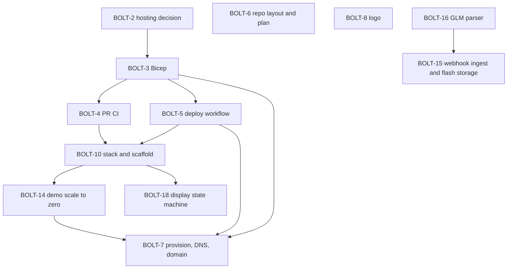

# BoltClock technical plan

Behavior is specified in the requirements; the design is in [system-design.md](system-design.md). Hosting is one always-on container on Azure Container Apps ([ADR 0001](decisions/0001-container-apps.md), [infra/README.md](../infra/README.md)).

## Definition of done

For every story: the change merged through a pull request, CI green, Bicep and docs updated when the change touches them, and the Jira story closed. Branch names, commits and pull request titles include the key `BOLT-N`.

## How work is tracked

Every piece of work that changes the tracked repo gets an entry here and a BOLT story on the project board before it starts. The entry and the story describe the same work. When the work changes, both change in the same pass. A story moves to In Progress when work starts and to Done when its pull request merges.

## Order

## Stories

### BOLT-1 — Azure infrastructure (epic)

Run BoltClock as one container in Azure. The repo holds a template anyone can deploy with their own names. Resource names, IDs, the domain, emails and keys stay in gitignored files and GitHub secrets. Groups BOLT-2, BOLT-3, BOLT-4, BOLT-5 and BOLT-7.

### BOLT-2 — Choose Azure hosting (ADR 0001)

Container Apps, Consumption profile, one replica that never scales to zero, East US next to the NOAA bucket, images on GitHub Container Registry, OIDC deploys. Recorded in [decisions/0001-container-apps.md](decisions/0001-container-apps.md).

Blocks BOLT-3.

### BOLT-3 — Bicep for Azure hosting, no apply

`infra/main.bicep` with every deployment-specific value as a parameter: Log Analytics, the Container Apps environment, the container app (HTTPS ingress, `/health` probes, 0.25 vCPU / 0.5 GiB, one replica), the Maps key as a Container Apps secret, an optional custom-domain binding, an optional GitHub OIDC deploy identity, and an optional budget. A `deployApp` switch lets the first deploy run before an image exists. `infra/main.bicepparam.example` with empty private fields and secrets read from the environment. `infra/README.md` with the deploy steps. A hosting section in the README and the deployment section of the system design.

Blocked by BOLT-2. Blocks BOLT-4, BOLT-5 and BOLT-7.

### BOLT-4 — Pull request CI

`.github/workflows/pr.yml`: build the Bicep and the example parameters, and build the Docker image once a `Dockerfile` exists. Lint and tests join as code lands. No cloud credentials.

Blocked by BOLT-3.

### BOLT-5 — Image publish and deploy workflow

`.github/workflows/deploy.yml` on push to `main`: push `ghcr.io/<owner>/boltclock` tagged `sha-<commit>` and `prod`, log in with OIDC, update the container app to the commit tag, then wait for a healthy revision and check `/health`. All identifiers come from `production` environment secrets. It skips the build until a `Dockerfile` exists and skips Azure until the secrets exist.

Blocked by BOLT-3. Blocks BOLT-7.

### BOLT-6 — Repo layout and plan

Organize the repo like the sibling projects: this plan, `docs/decisions/` for ADRs, `assets/` for brand files, `infra/` for Bicep, and `pr.yml` plus `deploy.yml`. README sections for hosting and brand, with existing sections left as they are.

### BOLT-7 — Provision Azure resources, DNS and custom domain

The owner's step. Preview and deploy with `deployApp = false`, add the GitHub secrets, let the first build publish the image, make the package public, deploy with `deployApp = true`, then add the DNS records, bind the managed certificate and record its ID in the private parameter file.

Blocked by BOLT-3 and BOLT-5.

### BOLT-8 — Logo

`assets/logo.svg` (navy tile, cream alarm clock with beige bells and a `#CDBFA8` rim, two-tone electric-cyan bolt striking to the centre; readable at 16 px), `assets/logo-mark.svg` (transparent, outlined), and PNG copies exported from them: `logo.png` 1024×1024 and `logo-mark.png` 912×1032.

A yellow-bolt alternate is kept next to them but not used: `logo-yellow.svg`, `logo-mark-yellow.svg` and their PNG copies. Cyan is the brand for now.

### BOLT-9 — Keep the Jira site out of public text

Tracked files, commit messages and pull request descriptions name no real resources, IDs, keys or environment-specific domains and URLs. Replace the board link in this plan with plain text, and change the Jira links in the pull request descriptions to plain `BOLT-N` keys.

### BOLT-10 — Stack decision (ADR 0002) and app scaffold

Node 24 LTS and TypeScript, Fastify, a Vite front end with no framework, Vitest, and `h5wasm` for GLM parsing, recorded in [decisions/0002-node-typescript.md](decisions/0002-node-typescript.md). The scaffold: a Fastify server with `/health`, config from the environment and the built client served from the same port; a placeholder display with the data credits and required disclaimers on one line and the same site credit as the sibling projects (designer and source links); Vitest, ESLint and a typecheck; `npm run dev` for local work; a multi-stage non-root `Dockerfile`; and `pr.yml` running lint, typecheck, tests and the build. The GLM parser, push channel and weather relay come in later stories.

Blocked by BOLT-4 and BOLT-5.

### BOLT-11 — Fix the Reader role ID in the Bicep (bug)

The deploy identity's Reader assignment on the resource group used a role definition ID that does not exist, so the first deploy failed on it with `RoleDefinitionDoesNotExist`. Use the built-in Reader ID, `acdd72a7-3385-48ef-bd42-f606fba81ae7`, and redeploy.

### BOLT-14 — Demo hosting: scale to zero and a session time limit

The hosted instance is a demo, so it scales to zero between visits instead of running around the clock ([decisions/0003-demo-scale-to-zero.md](decisions/0003-demo-scale-to-zero.md)). Bicep gains `minReplicas` (0 or 1) with an HTTP scale rule, and `sessionLimitMinutes`, passed to the app as `SESSION_LIMIT_MINUTES`. The server reads and validates it; the push channel story enforces it by ending the stream with a `session ended` event, after which the display stops reconnecting, treats the data as stale and asks for a reload. The deploy workflow wakes a scaled-to-zero revision while it waits for health. The system design, `infra/README.md`, the README and `.env.example` describe it.

Blocked by BOLT-10. Blocks BOLT-7.

### BOLT-15 — Lightning ingest: NOAA SNS via a Lambda relay into an Azure Function, flashes in Table Storage

NOAA's GOES-19 topic for new objects accepts only Lambda and SQS subscribers, so a tiny relay Lambda in the deployer's AWS account (`infra/aws/relay.yaml`) is subscribed to it, filtered to `GLM-L2-LCFA/` keys. The relay forwards each signed SNS record to a small Azure Function on the Flex Consumption plan, so the scale-to-zero container is not woken every 20 seconds. The Function verifies NOAA's signature, parses the file with the BOLT-16 parser and stores one row per flash in Azure Table Storage: one table per UTC hour, PartitionKey a 1° latitude/longitude cell, RowKey the sortable flash time plus its id. A query for strikes within a radius in the last T minutes (the display's time limit, default 30, capped at 120) reads only the cells the circle overlaps, then applies the exact great-circle distance. Data is kept for 120 minutes: the Function deletes older hourly tables as it writes, and readers always filter by time. This story adds the Bicep for the storage account, Function App, Application Insights and roles, the deploy step for the function package, the CloudFormation relay, and ADR 0004. No credentials cross clouds, and no one-per-subscription free offer is used.

Blocked by BOLT-16.

### BOLT-16 — GLM-L2-LCFA parser

`src/server/glm/parse.ts` reads one GOES-19 GLM-L2-LCFA file with `h5wasm` and returns its coverage window and flashes (id, time, latitude, longitude, quality), applying `_Unsigned`, `scale_factor`, `add_offset` and the `units` base time the way a NetCDF reader would. Degraded flashes are left out by default. `src/server/glm/filename.ts` reads times from object names and builds hourly prefixes, across day and year boundaries. Tests compare a committed real file with an independent `xarray` read of it and cover empty files, year rollover and unsigned ids. [glm-format.md](glm-format.md) documents the variables and the flash counts measured for BOLT-15.

Blocks BOLT-15.

### BOLT-18 — Display state machine

`src/shared/display-state.ts` is the display's state machine as a pure module with no DOM, timers or network. It takes flashes, heartbeats, the session-ended signal, the clock and the display settings, and returns the next state, the events to announce (alert, repeat, all-clear) and a view model (state, MM:SS countdown, nearest recent strike in the unit the radius was entered in, stale flag). The countdown runs from the strike time on the server's clock; another strike extends it, with a repeat only when the replay setting is on; all-clear waits while the data is stale (newest GLM file over 3 minutes old, no heartbeat yet, or the session ended). Flashes are deduplicated by id and ignored once older than the time limit. A page load rebuilds the state from the server's replay without announcing; a reconnect's replay is deduplicated. Tests cover each rule.

Blocked by BOLT-10.
