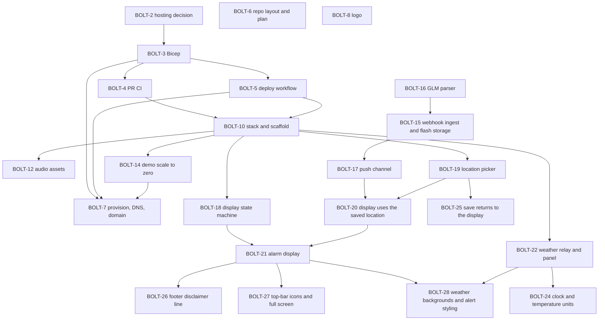

# BoltClock technical plan

Behavior is specified in the requirements; the design is in [system-design.md](system-design.md). Hosting is one always-on container on Azure Container Apps ([ADR 0001](decisions/0001-container-apps.md), [infra/README.md](../infra/README.md)).

## Definition of done

For every story: the change merged through a pull request, CI green, Bicep and docs updated when the change touches them, and the Jira story closed. Branch names, commits and pull request titles include the key `BOLT-N`.

## How work is tracked

Every piece of work that changes the tracked repo gets an entry here and a BOLT story on the project board before it starts. The entry and the story describe the same work. When the work changes, both change in the same pass. A story moves to In Progress when work starts and to Done when its pull request merges.

## Order

## Stories

### BOLT-1 — Azure infrastructure (epic)

Run BoltClock as one container in Azure. The repo holds a template anyone can deploy with their own names. Resource names, IDs, the domain, emails and keys stay in gitignored files and GitHub secrets. Groups BOLT-2, BOLT-3, BOLT-4, BOLT-5 and BOLT-7.

### BOLT-2 — Choose Azure hosting (ADR 0001)

Container Apps, Consumption profile, one replica that never scales to zero, East US next to the NOAA bucket, images on GitHub Container Registry, OIDC deploys. Recorded in [decisions/0001-container-apps.md](decisions/0001-container-apps.md).

Blocks BOLT-3.

### BOLT-3 — Bicep for Azure hosting, no apply

`infra/main.bicep` with every deployment-specific value as a parameter: Log Analytics, the Container Apps environment, the container app (HTTPS ingress, `/health` probes, 0.25 vCPU / 0.5 GiB, one replica), the Maps key as a Container Apps secret, an optional custom-domain binding, an optional GitHub OIDC deploy identity, and an optional budget. A `deployApp` switch lets the first deploy run before an image exists. `infra/main.bicepparam.example` with empty private fields and secrets read from the environment. `infra/README.md` with the deploy steps. A hosting section in the README and the deployment section of the system design.

Blocked by BOLT-2. Blocks BOLT-4, BOLT-5 and BOLT-7.

### BOLT-4 — Pull request CI

`.github/workflows/pr.yml`: build the Bicep and the example parameters, and build the Docker image once a `Dockerfile` exists. Lint and tests join as code lands. No cloud credentials.

Blocked by BOLT-3.

### BOLT-5 — Image publish and deploy workflow

`.github/workflows/deploy.yml` on push to `main`: push `ghcr.io/<owner>/boltclock` tagged `sha-<commit>` and `prod`, log in with OIDC, update the container app to the commit tag, then wait for a healthy revision and check `/health`. All identifiers come from `production` environment secrets. It skips the build until a `Dockerfile` exists and skips Azure until the secrets exist.

Blocked by BOLT-3. Blocks BOLT-7.

### BOLT-6 — Repo layout and plan

Organize the repo like the sibling projects: this plan, `docs/decisions/` for ADRs, `assets/` for brand files, `infra/` for Bicep, and `pr.yml` plus `deploy.yml`. README sections for hosting and brand, with existing sections left as they are.

### BOLT-7 — Provision Azure resources, DNS and custom domain

The owner's step. Preview and deploy with `deployApp = false`, add the GitHub secrets, let the first build publish the image, make the package public, deploy with `deployApp = true`, then add the DNS records, bind the managed certificate and record its ID in the private parameter file.

Blocked by BOLT-3 and BOLT-5.

### BOLT-8 — Logo

`assets/logo.svg` (navy tile, cream alarm clock with beige bells and a `#CDBFA8` rim, two-tone electric-cyan bolt striking to the centre; readable at 16 px), `assets/logo-mark.svg` (transparent, outlined), and PNG copies exported from them: `logo.png` 1024×1024 and `logo-mark.png` 912×1032.

A yellow-bolt alternate is kept next to them but not used: `logo-yellow.svg`, `logo-mark-yellow.svg` and their PNG copies. Cyan is the brand for now.

### BOLT-9 — Keep the Jira site out of public text

Tracked files, commit messages and pull request descriptions name no real resources, IDs, keys or environment-specific domains and URLs. Replace the board link in this plan with plain text, and change the Jira links in the pull request descriptions to plain `BOLT-N` keys.

### BOLT-10 — Stack decision (ADR 0002) and app scaffold

Node 24 LTS and TypeScript, Fastify, a Vite front end with no framework, Vitest, and `h5wasm` for GLM parsing, recorded in [decisions/0002-node-typescript.md](decisions/0002-node-typescript.md). The scaffold: a Fastify server with `/health`, config from the environment and the built client served from the same port; a placeholder display with the data credits and required disclaimers on one line and the same site credit as the sibling projects (designer and source links); Vitest, ESLint and a typecheck; `npm run dev` for local work; a multi-stage non-root `Dockerfile`; and `pr.yml` running lint, typecheck, tests and the build. The GLM parser, push channel and weather relay come in later stories.

Blocked by BOLT-4 and BOLT-5.

### BOLT-11 — Fix the Reader role ID in the Bicep (bug)

The deploy identity's Reader assignment on the resource group used a role definition ID that does not exist, so the first deploy failed on it with `RoleDefinitionDoesNotExist`. Use the built-in Reader ID, `acdd72a7-3385-48ef-bd42-f606fba81ae7`, and redeploy.

### BOLT-12 — Audio assets: selectable siren, announcements, chime

The sound files only; playback, sequencing, the autoplay unlock and the settings screen come in a later story.

- **Siren**, chosen in settings: No siren, Two-tone (hi-lo, mildest), Mechanical (slow civil-defense wail) or Yelp (fast sweeps, most urgent). A script synthesizes them, so they are original, and renders them to `assets/audio/`. "No siren" goes straight to the announcement.
- **Announcements**: whole sentences rendered in advance with ElevenLabs instead of spliced numbers, so the intonation stays natural. "Lightning detected N miles away" for 0–100 and "N kilometers away" for 0–161, with "1 mile", "less than 1 mile" for 0, plus "Lightning detected in the area." without a distance and "No lightning detected in the area." A development-time script fixes the voice, model and settings. The 265 MP3 files are committed as rendered, and the app loads only the clip it needs. `ELEVENLABS_API_KEY` is read from `.env` by the script only, never by the running app.
- **Chime**: a rising three-note bell before the all-clear, synthesized like the sirens.
- **Docs**: [audio-plan.md](audio-plan.md) updated for the siren choice and the pre-rendered clips, and the README credits the sounds.

Blocked by BOLT-10.

### BOLT-13 — Move the GitHub Actions to their Node 24 majors

GitHub warns that the actions in `pr.yml` and `deploy.yml` run on the deprecated Node 20. Move them to the current majors, which run on Node 24: `actions/checkout` v7, `actions/setup-node` v7, `docker/setup-buildx-action` v4, `docker/login-action` v4, `docker/metadata-action` v6, `docker/build-push-action` v7 and `azure/login` v3. Their breaking changes do not touch the inputs the workflows use. `ubuntu-latest` moves to Ubuntu 26.04 from 2026-10-19 and stays: the workflows need only bash, curl, Docker with Buildx and the Azure CLI, which both images have. The deploy gating and the secret names do not change.

### BOLT-14 — Demo hosting: scale to zero and a session time limit

The hosted instance is a demo, so it scales to zero between visits instead of running around the clock ([decisions/0003-demo-scale-to-zero.md](decisions/0003-demo-scale-to-zero.md)). Bicep gains `minReplicas` (0 or 1) with an HTTP scale rule, and `sessionLimitMinutes`, passed to the app as `SESSION_LIMIT_MINUTES`. The server reads and validates it; the push channel story enforces it by ending the stream with a `session ended` event, after which the display stops reconnecting, treats the data as stale and asks for a reload. The deploy workflow wakes a scaled-to-zero revision while it waits for health. The system design, `infra/README.md`, the README and `.env.example` describe it.

Blocked by BOLT-10. Blocks BOLT-7.

### BOLT-15 — Lightning ingest: NOAA SNS via a Lambda relay into an Azure Function, flashes in Table Storage

NOAA's GOES-19 topic for new objects accepts only Lambda and SQS subscribers, so a tiny relay Lambda in the deployer's AWS account (`infra/aws/relay.yaml`) is subscribed to it, filtered to `GLM-L2-LCFA/` keys. The relay forwards each signed SNS record to a small Azure Function on the Flex Consumption plan, so the scale-to-zero container is not woken every 20 seconds. The Function verifies NOAA's signature, parses the file with the BOLT-16 parser and stores one row per flash in Azure Table Storage: one table per UTC hour, PartitionKey a 1° latitude/longitude cell, RowKey the sortable flash time plus its id. A query for strikes within a radius in the last T minutes (the display's time limit, default 30, capped at 120) reads only the cells the circle overlaps, then applies the exact great-circle distance. Data is kept for 120 minutes: the Function deletes older hourly tables as it writes, and readers always filter by time. This story adds the Bicep for the storage account, Function App, Application Insights and roles, the deploy step for the function package, the CloudFormation relay, and ADR 0004. No credentials cross clouds, and no one-per-subscription free offer is used.

Blocked by BOLT-16.

### BOLT-16 — GLM-L2-LCFA parser

`src/server/glm/parse.ts` reads one GOES-19 GLM-L2-LCFA file with `h5wasm` and returns its coverage window and flashes (id, time, latitude, longitude, quality), applying `_Unsigned`, `scale_factor`, `add_offset` and the `units` base time the way a NetCDF reader would. Degraded flashes are left out by default. `src/server/glm/filename.ts` reads times from object names and builds hourly prefixes, across day and year boundaries. Tests compare a committed real file with an independent `xarray` read of it and cover empty files, year rollover and unsigned ids. [glm-format.md](glm-format.md) documents the variables and the flash counts measured for BOLT-15.

Blocks BOLT-15.

### BOLT-17 — Push channel: nearby strikes and heartbeats over SSE

`GET /api/stream?lat&lon&radiusKm&minutes` opens a server-sent events stream (build step 3). On connect it replays the flashes within the radius from the display's time-limit window, read from the BOLT-15 flash tables with the container app's managed identity, followed by a heartbeat with the newest GLM file end time. Every ~15 s it reads again, looking back three minutes for late files, and sends only flashes this connection hasn't seen, plus a heartbeat. If a read fails it skips the heartbeat, so the display goes stale. After `SESSION_LIMIT_MINUTES` it sends `session-ended` and closes (ADR 0003). On shutdown, open streams are closed. Message shapes live in `src/shared/messages.ts`. The browser client `src/client/stream.ts` reconnects automatically, drops replayed duplicates, and stops after a session ends. Until the settings screen exists, the display reads its point from the address and shows connection state, data age and the nearby strike count in the status line.

Blocked by BOLT-15.

### BOLT-18 — Display state machine

`src/shared/display-state.ts` is the display's state machine as a pure module with no DOM, timers or network. It takes flashes, heartbeats, the session-ended signal, the clock and the display settings, and returns the next state, the events to announce (alert, repeat, all-clear) and a view model (state, MM:SS countdown, nearest recent strike in the unit the radius was entered in, stale flag). The countdown runs from the strike time on the server's clock; another strike extends it, with a repeat only when the replay setting is on; all-clear waits while the data is stale (newest GLM file over 3 minutes old, no heartbeat yet, or the session ended). Flashes are deduplicated by id and ignored once older than the time limit. A page load rebuilds the state from the server's replay without announcing; a reconnect's replay is deduplicated. Tests cover each rule.

Blocked by BOLT-10.

### BOLT-19 — Location picker

`/location.html`, linked from the display, is where the user chooses the point and the radius that lightning distances are measured from. A Google Maps JavaScript API map shows a draggable pin and the radius as a circle; a click on the map or a drag of the pin sets the point. The map opens on the browser's location, then the saved point, then a continental-US view with a message. Address search uses Places API (New) `AutocompleteSuggestion` with a session token: typing is debounced and needs three characters, and choosing a result ends the session with one Place Details call that fetches only `location`. A search only moves the pin. The radius is a value and a unit (mi or km) stored exactly as entered, 10 mi by default and at most 100 mi or the km equivalent. Only the coordinates and the radius are saved, in the browser's local storage; the address and the search text are never stored or logged. The browser key and an optional Map ID reach the page from `GET /api/client-config` (`GOOGLE_MAPS_API_KEY`, `GOOGLE_MAPS_MAP_ID`). For local work a gitignored `.env.local` overrides `.env`, so a key restricted to localhost can sit next to the production one. Google's attribution stays on the map, and the page carries the display's credits and disclaimers. Tests cover the config route, saving and loading the point and radius, and the search session. Wiring the display to the saved point comes after BOLT-17.

Blocked by BOLT-10.

### BOLT-20 — Display watches the saved location

The display stops requiring `?lat&lon` in the address and watches the point and radius saved by the BOLT-19 picker. `?lat&lon` (with optional `radius`, `unit` and `minutes`) still wins, so a kiosk can be pinned to a point by its URL; otherwise the saved location is used; with neither, the display links to `/location.html`. The saved radius, kept as entered, becomes the stream's `radiusKm` (miles converted, capped at the server limit), and the status line shows it in its own unit. The time window stays at the 30-minute default until the settings screen exists. `src/client/display-settings.ts` resolves this as a pure function, tested for the saved location, the address, both, and neither.

Blocked by BOLT-17 and BOLT-19.

### BOLT-21 — Alarm display: countdown, sound, Start button and test mode

The display becomes the alarm (build steps 7 and 9, plus the test mode from step 10).

- **States:** `src/client/display-controller.ts` runs the BOLT-18 state machine for the page. The first replay rebuilds silently, so a reload never re-sounds the siren. Later flashes, heartbeats and a one-second tick step it, and its events become announcements.
- **Screens:**
  - NORMAL: an all-clear screen.
  - ALERT: a red screen with a countdown filling about 30% of the screen height, counted from the strike's time, and the nearest strike in the radius's unit.
  - "NO LIGHTNING DATA": an overlay while data is stale or the session has ended.
- **Sound** (`src/client/audio.ts`): A is siren, gap, distance sentence; B is chime, gap, all-clear sentence. A newer announcement interrupts the current one, the volume is a gain node, and the browser's speech reads any clip that fails to load. The sentences move to `src/shared/announcements.ts`, shared with the renderer.
- **Start display** unlocks sound and enters full screen. A banner stays up while sound is locked.
- **Device settings** (`alert-settings.ts`): siren, volume, replay during a countdown, countdown length (1–120), and test buttons. `?minutes=` pins the countdown on a kiosk.
- **Test mode:** `TEST_MODE` (Bicep `testMode`, default off) shows "Simulate a strike", a local, labelled fake flash at 60% of the radius.
- **Docs:** the README covers the display and a kiosk autoplay setup.

Blocked by BOLT-18 and BOLT-20.

### BOLT-22 — Weather relay and weather panel

Build step 4. Browsers cannot set the User-Agent api.weather.gov requires, so the server relays it. `GET /api/weather?lat&lon` validates the point, then calls NWS `/points` (cached for 6 hours, keyed by the point at NWS's 4-decimal precision), the nearest station's latest observation (every 10 minutes; the next of the three nearest stations when one has no temperature in the last 2 hours) and the hourly forecast (every 30 minutes). It answers the shape in `src/shared/weather.ts`: the current temperature, condition text, NWS icon, a normalized condition (clear day or night, cloudy, rain, thunderstorm, fog, snow, wind) for the backgrounds story, wind speed, gusts and direction, the observation time, and the next 2 forecast hours, in °F and mph. Every NWS request carries `NWS_USER_AGENT`; without it the route answers 503 and the server warns once at startup. Caches are in memory, per process. On 429, a 5xx or a network failure the relay waits about 5 s (longer if Retry-After says so) and tries up to 3 times, then serves the cached copy marked stale and leaves NWS alone for a minute. Points NWS has no grid for get an "outside coverage" answer, cached like any other. Coordinates are never logged. The display's weather panel (`src/client/weather-panel.ts`, its own CSS) shows the temperature, condition, wind and the next 2 hours, readable at 20 ft, refreshes every 10 minutes, shows the observation's age and credits the National Weather Service. It draws into the `#weather` slot that the BOLT-21 alarm layout provides, mounted by one call, `mountWeatherPanel(document.getElementById('weather'), point)`, with its styles scoped under `.weather`.

Blocked by BOLT-10.

### BOLT-23 — Replay the siren during a countdown: off by default

The display's "Replay the siren for each new strike during a countdown" setting now defaults to off (Henrique, 2026-10-17). The first strike in the radius still sounds the full alarm, and every later strike still restarts the countdown; repeating the siren and announcement is opt-in in the settings. A device that already saved its alert settings keeps its saved choice.

### BOLT-24 — Clock and temperature units; forecast times on one line

The display's settings add a clock choice, 12-hour ("3 PM", the default) or 24-hour ("15:00"), and a temperature choice, °F (the default) or °C (Henrique, 2026-10-17). Both are saved on the device with the other alert settings and apply to the weather panel at once, without a reload. NWS still reports °F; the panel converts and rounds to a whole degree. A forecast row's time, temperature and chance of precipitation never wrap onto a second line; only the condition text may wrap.

Blocked by BOLT-22.

### BOLT-25 — Save location returns to the display

After a successful "Save location" on the picker, the browser goes straight back to the display, which starts watching the new point (Henrique, 2026-10-17). If the browser will not save (site data blocked), the picker stays open and shows the error as before.

Blocked by BOLT-19.

### BOLT-26 — Footer: disclaimers on their own line

In the footer of the display and the location picker, the disclaimers ("Strike locations are accurate within ±5 miles. Not a certified lightning warning system. When thunder roars, go indoors. Strikes can be missed or arrive up to a minute late.") get their own line below the data credits. The picker's footer drops "Map and place search: Google Maps.": Google's attribution is the logo and data credit on the map, which stays, and the search suggestions already say "Search results from Google Maps".

### BOLT-27 — Top bar: icon buttons and full screen on request

**Start display** turns on sound only and no longer enters full screen. The top-bar buttons become icons with tooltips and accessible names: a lightning bolt for the test strike, a gear for Settings, a map pin for Location, and a new full-screen button to the right of Location, hidden where the browser cannot go full screen. In full screen, whether from the button or F11, the top-right buttons (test strike, Settings, Location, full screen) are hidden; Esc or F11 brings them back.

### BOLT-28 — Weather backgrounds and alert styling

Build step 8. The display's full-screen background matches the current weather: clear day, clear night, cloudy, rain, thunderstorm, fog, snow and wind, plus a neutral navy while the weather is unknown. `src/client/weather-background.ts` picks the scene as a pure function: the current observation's condition, else the first forecast hour's, else neutral (also outside NWS coverage and before the first answer). A failed refresh keeps the last scene, and `?background=<scene>` previews one. The weather panel reports each answer through a callback, so there is no second poller; the display sets `data-weather` on the body and draws the scene. The art is original inline SVG and CSS in the brand colours, with no images. Every sky keeps paper text at 7:1 contrast or better, motion is slow and stops under `prefers-reduced-motion`, and scenes crossfade. ALERT hides the weather art and shows a red field with amber-and-black hazard bands, so it never looks like the thunderstorm scene (dark indigo, no red or amber). Tests cover the mapping, the preview parameter, the sky and alert contrast, and the art markup.

Blocked by BOLT-21 and BOLT-22.
